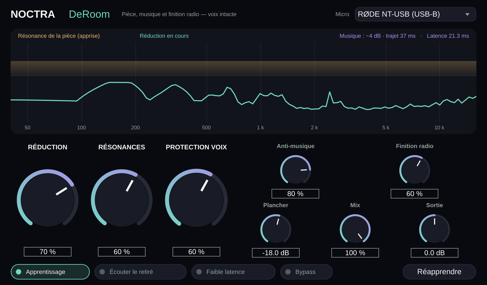

# Noctra DeRoom — VST3 voix : pièce, musique et finition radio

Plugin VST3 (et AU sur macOS, plus une application autonome) pensé pour une voix captée au
**RØDE NT-USB d'origine (USB-B)** dans une pièce non traitée, en **temps réel**.



Trois traitements en un, tous légers et sans intelligence artificielle :

1. **Résonance de la pièce** : retire la réverbe tardive et surtout les **modes de la pièce**
   (ondes stationnaires, son « boîte » dans le grave/bas-médium), sans toucher aux parties où
   la voix directe domine.
2. **Anti-musique** : si de la musique passe dans vos enceintes, le plugin la retire du micro.
   Il faut lui envoyer cette musique sur son **entrée sidechain** (voir plus bas).
3. **Finition radio** : coupe-bas, chaleur, air, de-esser, nivellement, compression et limiteur
   pour un rendu « studio, limite radio », réglé par un seul bouton.

## Comment ça marche

| Module | Méthode |
| --- | --- |
| Pièce | STFT 1024 points (512 en faible latence), 75 % de recouvrement. Modèle statistique de réverbération tardive dont le **profil est appris** par bande : durée de décroissance (RT60) mesurée sur les fins de syllabes, et niveau de queue rapporté à la voix. Les modes ressortent comme des bandes qui sonnent plus longtemps que leurs voisines ; le bouton *Résonances* les vise en priorité. Soustraction en puissance (pas de « creusement »), protection des composantes de voix directe, lissage anti « bruit musical », plancher qui respecte le bruit de fond 16 bits du NT-USB (pas de pompage). |
| Musique | Annulation d'écho acoustique temporelle exacte (filtre adaptatif en blocs fréquentiels partitionnés, comme Speex et WebRTC), 200 ms de trajet enceintes → pièce → micro, retard (latence de la carte son comprise) trouvé tout seul. **Double filtre** : un filtre de fond apprend en permanence, et celui qu'on entend ne le recopie que s'il retire mesurablement plus. Ainsi, parler par-dessus ne dérègle pas ce qu'on entend. Le résidu est ensuite atténué comme la réverbe. Stéréo gérée (un filtre par canal de musique). |
| Finition | Filtres IIR et détecteurs sans anticipation : **aucune latence ajoutée**. Coupe-bas 60–90 Hz (4e ordre), chaleur +2 dB à 140 Hz, -2,5 dB à 320 Hz (son « carton »), air +3 dB à 10 kHz, de-esser 5–9 kHz, nivellement lent (le NT-USB d'origine n'a pas de réglage de gain, les prises sont souvent basses), compresseur jusqu'à 4:1, expandeur doux entre les phrases, limiteur à -1 dBFS. Valeurs indiquées pour 100 %. |

Le profil **RØDE NT-USB (USB-B)** tient compte du micro : cardioïde (peu de réverbe captée dans
l'aigu), bosse de présence vers 5–10 kHz qui porte les sifflantes et l'air (la suppression y est
adoucie), convertisseur 16 bits / 48 kHz (bruit de fond pris en compte), pas de gain matériel.

## Résultats mesurés

Banc d'essai fourni (`tests/engine_test.cpp`) : voix synthétique passée dans des pièces simulées
avec modes résonants, bruit et quantification 16 bits façon NT-USB. Réglages par défaut :
réduction 70 %, résonances 60 %, protection voix 60 %.

| Situation | Résultat |
| --- | --- |
| Voix sèche (aucune pièce) | transparente : -0,1 dB, timbre à 0,3–0,8 dB près, bruit de fond conservé (-0,3 dB) |
| NT-USB sur un bureau, petite pièce | réverbe tardive -8 dB, modes -8 dB, « bosse » < 400 Hz pendant la parole ramenée de +4,9 à +1,2 dB, aucune bande de la voix creusée de plus de 1,2 dB |
| Cabine « boîte », chambre, salon (RT 0,8 s) | réverbe -7 à -10 dB, bosse des modes réduite de 3 à 5 dB pendant la parole |
| Musique sur les enceintes (sidechain) | musique seule -23,7 dB, encore -21 dB après avoir parlé par-dessus. Sous une musique forte (à peine 10 dB sous la voix), le timbre de la voix bouge un peu (≈ 3 à 3,5 dB d'écart par bandes, contre 6 dB d'écart dû à la pièce elle-même) |
| Faible latence | 10,7 ms au lieu de 21,3 ms à 48 kHz, même efficacité (réverbe -6,8 dB) |
| Finition radio 60 % | prise à -38 dBFS RMS ramenée vers -23 dBFS, crêtes sous -1 dBFS, aigus non agressifs |
| Processeur | ~1,2 % d'un cœur en stéréo 48 kHz, ~3,5 % avec la musique (machine de test partagée, chiffres affichés à chaque exécution) |

`pluginval` (outil de validation de Tracktion), niveau de rigueur maximal 10 : **SUCCESS**.

**À savoir honnêtement :**

- Ces mesures sont faites sur des signaux **synthétiques**. Rien ne remplace un essai sur vos
  propres prises : réglez *Réduction* à l'oreille et utilisez **Écouter le retiré** pour vérifier
  qu'il n'y a que de la pièce (et de la musique) dans ce qui est enlevé, pas de voix.
- Je ne peux pas comparer directement avec Clear (Antinode / ex-Supertone), qui repose sur un
  réseau de neurones. DeRoom vise spécifiquement les **résonances de la pièce**, avec un coût
  processeur très faible. Sur une réverbe diffuse énorme, un modèle neuronal peut aller plus loin.
- L'anti-musique **a besoin de la musique en sidechain**. Sans elle, aucune méthode légère ne peut
  retirer de la musique sous une voix sans l'abîmer. Il faut quelques secondes de musique pour
  qu'il « accroche » (plus longtemps si vous parlez sans arrêt dès le départ). Le casque reste la
  solution parfaite : le NT-USB a une sortie casque sans latence.
- Le profil de pièce s'apprend en quelques secondes de parole. Il est sauvegardé avec le projet,
  et *Réapprendre* l'efface si vous changez de pièce ou de placement.

## Réglages

| Réglage | Rôle | Défaut |
| --- | --- | --- |
| Réduction | Force du retrait de la pièce (0 = transparent) | 70 % |
| Résonances | Précision et priorité données aux modes | 60 % |
| Protection voix | Laisse intactes les composantes où la voix directe domine | 60 % |
| Anti-musique | Retrait de la musique des enceintes (si sidechain branché) | 80 % |
| Finition radio | Rendu studio / radio (0 = aucune finition) | 60 % |
| Plancher | Atténuation maximale par bande | -18 dB |
| Mix / Sortie | Dosage original / traité, gain final | 100 % / 0 dB |
| Micro | Générique ou RØDE NT-USB (USB-B) | NT-USB |
| Apprentissage | Désactiver pour figer le profil de pièce une fois appris | activé |
| Écouter le retiré | N'entendre que ce qui est enlevé | désactivé |
| Faible latence | ~11 ms au lieu de ~21 ms (un peu moins de précision dans le grave) | désactivé |

## Temps réel avec le NT-USB

- La latence (21,3 ms, ou 10,7 ms en *Faible latence*) est annoncée à l'hôte, qui la compense.
- Pour vous entendre sans aucun retard, branchez le casque **sur le NT-USB** (retour direct du
  micro). Le traitement s'applique à ce qui est enregistré ou diffusé.
- Si vous vous écoutez **à travers** le plugin, activez *Faible latence*.

## Brancher la musique sur le sidechain

Le plugin a une seconde entrée stéréo, « Musique (sidechain) ». Il faut y envoyer **exactement**
ce qui part dans les enceintes :

- **REAPER** : sur la piste du micro, passez à 4 canaux. Depuis la piste de musique, créez un
  *send* vers la piste du micro sur les canaux 3/4. Le plugin les reçoit comme sidechain.
- **Ableton Live, Cubase, Studio One, FL Studio, Bitwig** : choisissez la piste de musique dans le
  sélecteur *Sidechain* du plugin.
- **Musique venant d'un navigateur ou de Spotify** : faites-la passer par un câble audio virtuel
  (VB-CABLE, Voicemeeter…). Le même signal doit à la fois partir vers les enceintes et arriver dans
  l'hôte, sur la piste envoyée en sidechain.
- **OBS** : à ma connaissance, son filtre VST ne charge que des VST 2, pas des VST 3. Passez par un
  hôte VST3 (REAPER, par exemple), ou utilisez l'application autonome avec un câble audio virtuel.

## Installer

**Sans compiler** : chaque modification de `vst/NoctraDeRoom` déclenche GitHub Actions
(*Noctra DeRoom (VST3)*). Téléchargez l'artefact `NoctraDeRoom-Windows` (ou macOS) de la dernière
exécution, puis copiez `Noctra DeRoom.vst3` dans :

- Windows : `C:\Program Files\Common Files\VST3\`
- macOS : `~/Library/Audio/Plug-Ins/VST3/` (et le `.component` dans `~/Library/Audio/Plug-Ins/Components/`)

**Compiler soi-même** (CMake ≥ 3.22, compilateur C++17 ; JUCE 8.0.4 est téléchargé automatiquement) :

```bash
cmake -S vst/NoctraDeRoom -B vst/NoctraDeRoom/build -DCMAKE_BUILD_TYPE=Release
cmake --build vst/NoctraDeRoom/build --config Release
ctest --test-dir vst/NoctraDeRoom/build -C Release --output-on-failure   # banc d'essai
```

Sous Linux, installez d'abord `libasound2-dev libx11-dev libxrandr-dev libxinerama-dev
libxcursor-dev libxcomposite-dev libfreetype-dev libfontconfig1-dev`.

## Structure

```
vst/NoctraDeRoom/
├── CMakeLists.txt
├── Source/
│   ├── DeRoomEngine.h       moteur (pièce + anti-musique), sans dépendance, sans allocation en temps réel
│   ├── VoiceFinish.h        finition studio / radio, sans latence
│   ├── PluginProcessor.*    enveloppe JUCE : paramètres, sidechain, sauvegarde du profil
│   └── PluginEditor.*       interface
└── tests/engine_test.cpp    banc d'essai objectif (lancé par ctest et par la CI)
```

## Licence

Le code de ce dossier fait partie de Noctra. Il utilise **JUCE 8**, distribué sous AGPLv3 ou sous
licence commerciale JUCE (gratuite en dessous d'un certain chiffre d'affaires, voir juce.com).
Pour diffuser le plugin, respectez l'une de ces deux licences.
